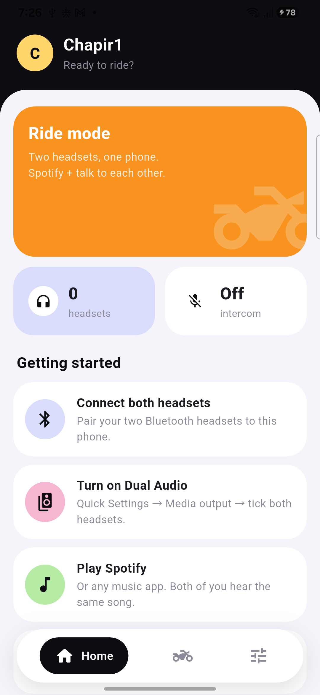
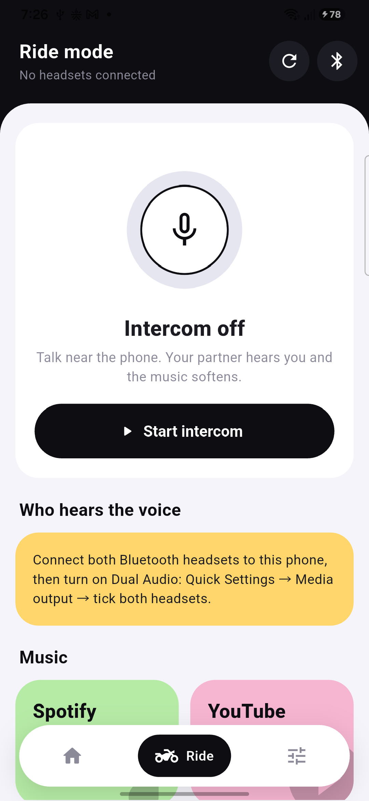

# Pillion

**One phone, two headsets. Share your music and talk to each other on the bike.**

Pillion is a free, open-source Android app for couples and friends riding together on one bike. Both riders hear the same songs from Spotify (or any music app) through their own Bluetooth headsets. When one of you speaks near the phone, the other hears you and the music automatically softens, then comes back when you stop.

No account, no server, no internet. Microphone audio never leaves the phone and is never recorded.

<p>
  
  &nbsp;
  
</p>

## Features

- **Ride mode (one phone).**
  - Plays music to two Bluetooth headsets at once using the phone's dual audio feature (Samsung Dual Audio, Android Audio Sharing / Auracast).
  - Works with any music app: Spotify, YouTube Music, local files, podcasts.
  - **Hands-free intercom:** the phone mic picks up speech automatically (no button to hold) and plays it into the headsets.
  - **Automatic music ducking:** the music gets quieter while someone talks and comes back after a short silence.
  - **No echo for the talker:** choose which headset hears the voice, so the person holding the phone doesn't hear themselves. A *Swap* button flips it when the phone changes hands.
  - Wind-rumble filter, noise suppression and adjustable sensitivity, voice volume and music-return delay.
  - Keeps running with the screen off (foreground service with a Stop button in the notification).
- **Music rooms (several phones).**
  - One phone hosts a room over Bluetooth Low Energy and others join with a PIN.
  - Every phone plays its own copy of the same MP3/M4A in sync (clock-offset estimation plus drift correction).
  - Each phone lowers its own music when speech is detected nearby, with optional group ducking.

## How to use Ride mode

1. **Connect both headsets** to the same phone (Settings → Connections → Bluetooth). A headset can only be connected to one phone at a time, so disconnect it from other phones first.
2. **Turn on dual audio.**
   - Samsung: swipe down for Quick Settings, tap **Media output** and tick **both** headsets.
   - Other phones: look for *Audio sharing* or *Auracast* in the Bluetooth settings.
3. **Play music** in Spotify or any app. Both of you should hear it.
4. Open Pillion → **Ride** tab → under *Who hears the voice*, tap the headset of the person **not** holding the phone.
5. Tap **Start intercom** and talk near the phone.

Tip: the phone mic hears whoever is closest, so the passenger holding the phone, or keeping it in a chest pocket, is usually the talker.

## Limitations

- **One microphone.** The app uses the phone's built-in mic, so it can't tell *who* is speaking. Pick the listener's headset to avoid echo. If both people need to talk equally, put the phone between you and choose *Both headsets*; the talker will then hear themselves slightly.
- **Headset microphones are not used.** On Android, using a Bluetooth headset mic switches that headset to call mode and stops high-quality music.
- **Wired and Bluetooth together isn't supported.** Android plays media to either the 3.5 mm jack or Bluetooth, not both at once.
- **Sending voice to one headset only** depends on the phone allowing per-device routing while dual audio is on. If it isn't allowed, the app shows a warning and the voice goes to both headsets.
- **Bluetooth latency.** Voice reaches the headsets roughly 0.2 s after it is spoken.
- **Android only** for Ride mode. The iOS project builds, but Ride mode needs Android APIs.

## Install

Download the APK from the Releases page (or build it yourself, see below), open it on your phone and allow *Install unknown apps* when asked. Android 8.0 or newer is required.

## Build from source

Requirements: [Flutter](https://docs.flutter.dev/get-started/install) 3.47 or newer and the Android SDK (platform 36).

```bash
git clone <this repo>
cd pillion
flutter pub get
flutter test                       # unit tests
flutter run                        # run on a connected phone (USB debugging on)
flutter build apk --release        # APK in build/app/outputs/flutter-apk/
```

The release build is currently signed with the debug key so it installs anywhere for testing. Add your own signing config in `android/app/build.gradle.kts` before publishing to a store.

## Project layout

```
android/app/src/main/kotlin/com/abu018/pillion/ride/
  IntercomEngine.kt     mic → filter → voice gate → headset audio, plus music ducking
  VoiceGate.kt          speech detector (energy + adaptive noise floor)
  RideService.kt        foreground service so it keeps running with the screen off
  RideController.kt     Flutter ⇄ Android bridge (method and event channels)
lib/
  services/ride/        Ride mode controller (Dart side)
  services/             rooms: BLE transport, sync, voice detection, ducking, playback
  core/                 protocol, message signing, clock, models
  ui/                   theme, screens and shared widgets
test/                   protocol, sync and ducking tests
bluetooth_group_music_app_spec.md   original specification for music rooms
```

## Privacy

- The microphone is only used while the intercom (or a room with ducking) is on, and only on the phone itself.
- Audio is processed in memory and discarded immediately. Nothing is recorded, stored or uploaded.
- Rooms exchange only playback commands and "someone is talking" flags over Bluetooth, signed with a key derived from the room PIN.

## Contributing

Issues and pull requests are welcome. Good first areas:

- Testing Ride mode on more phones (Pixel Audio Sharing, OnePlus, Xiaomi) and reporting whether per-headset voice routing works.
- A two-phone intercom mode, so each rider has their own microphone.
- Better wind-noise handling.

Please run `flutter analyze` and `flutter test` before opening a pull request.

## License

[MIT](LICENSE) © 2026 Abu018
